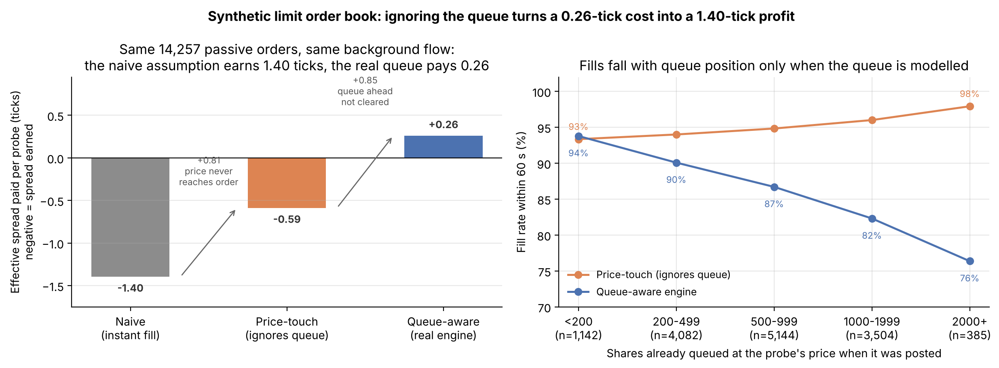
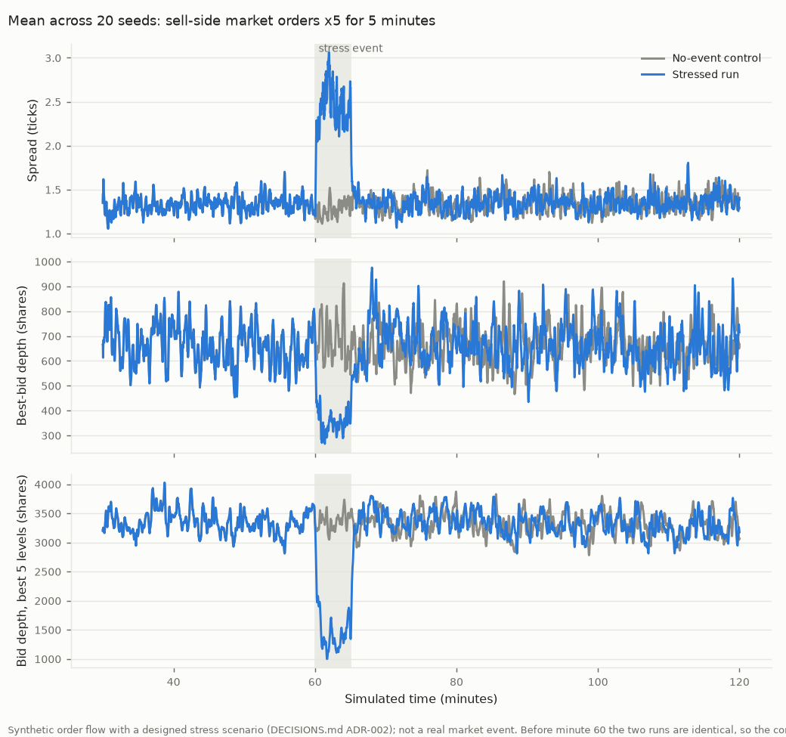

# Simplified Limit Order Book Simulator & Liquidity Event Study

[](https://github.com/mateeniqbal3/lob-simulator/actions/workflows/ci.yml)
[](LICENSE)



📄 **Working paper:** [`paper/writeup.pdf`](paper/writeup.pdf) (source: [`paper/writeup.md`](paper/writeup.md))

A limit order book matching engine with real price-time priority and
queue-position tracking. It is used for two things: a controlled
liquidity event study (how do spread, depth and resilience behave around
a stress event?) and a measurement of how much a naive "instant fill"
assumption overstates execution quality.

> **What this study is and isn't:** every result below comes from
> **synthetic order flow** with a deliberately injected stress scenario.
> It is a controlled methodology demonstration and describes the behavior
> of this model, **not** any real market, instrument or date. No real
> data was used (see [Scope & Data](#scope--data)).

---

## Problem statement & hypothesis

Market microstructure reasoning predicts that a burst of one-sided
aggressive order flow should do three things:
- consume the side of the book it hits;
- widen the bid-ask spread;
- leave the book needing measurable time to recover once the burst ends.

This project builds the infrastructure to test that directly. The
matching engine is exchange-style, not an approximation. The scenario
multiplies the arrival rate of market sell orders by 5 for 5 simulated
minutes, and measures:
- **H1:** the spread widens during the event;
- **H2:** bid-side depth falls during the event;
- **H3:** both recover within a finite time that is longer than a
  no-event placebo.

The same engine then answers a practical question. If a backtest assumes
passive orders fill instantly at the posted price, how wrong is it?

## Methodology & bias controls

- **Look-ahead bias:** prevented by construction, and tested.
  - The engine processes one event at a time and rejects any event
    timestamped earlier than one already processed.
  - A book snapshot "as of T" is taken before any later event is
    processed. A test confirms it equals a replay of only the events up
    to T ([`tests/test_simulation.py`](tests/test_simulation.py)).
  - A stress event scheduled at T provably leaves every earlier event
    unchanged
    ([`tests/test_order_flow.py`](tests/test_order_flow.py)).
  - At the engine level, see `test_no_lookahead` in
    [`tests/test_matching_engine.py`](tests/test_matching_engine.py).
- **Survivorship / selection bias:** not applicable to a single synthetic
  book. The one real-data source that might have introduced it (LOBSTER
  samples of large, liquid stocks) could not be obtained
  ([ADR-003](DECISIONS.md)).
- **Multiple-testing bias:** the event design, windows, metrics, recovery
  rule, the 20 seeds and a 9-cell robustness grid were recorded in
  [ADR-002](DECISIONS.md) before any stressed simulation ran. The fill
  comparison was likewise fixed in ADR-008 before it ran.
  - Every seed and every grid cell is reported.
  - The 7 no-event calibration configurations are disclosed
    ([ADR-001](DECISIONS.md)).
  - The only post-hoc change is a diagnostic in the fill comparison,
    also disclosed (ADR-008 addendum).
- **Controls, not just baselines:** every stressed run has a same-seed
  no-event twin, identical up to the event, so each effect is a paired
  difference. Recovery times are compared with a placebo, the same rule
  applied to the control.
- **Engine correctness first:** the analysis depends on it, so the
  verification is layered:
  - the five required tests;
  - volume conservation checked after every event on 60 adversarial
    random streams;
  - a differential test against an independent brute-force matcher;
  - a bug-reintroduction check, where 15 of 15 injected engine bugs are
    caught by the test written for them.

  See [`docs/engine_correctness.md`](docs/engine_correctness.md).

## Results: naive fill assumption vs. queue-aware simulation

A 100-share buy is posted at the best bid and a 100-share sell at the
best ask every 15 s. Each may wait 60 s before being completed with a
market order. That gives 14,257 probes over 20 seeds, all run on
**identical background order flow**:

| | Naive (instant fill, no queue) | Price-touch, no queue | Realistic (price-time priority + queue) |
|---|---|---|---|
| Fill rate | 100% | 94.8% | **86.9%** |
| Avg. fill price vs. posted | 0.00 ticks | +0.43 ticks worse | **+0.84 ticks worse** |
| Effective spread realized | −1.40 ticks (earned) | −0.59 ticks (earned) | **+0.26 ticks (paid)** |
| Median time to fill | 0 s | 3.3 s | 10.6 s |

**Mechanism:**
- **The sign flips.** The naive assumption books 1.40 ticks of spread
  captured per order. Run through the engine, the same orders pay 0.26
  ticks net.
- **Two roughly equal causes, separated by the price-touch middle
  column:**
  - 5.2 points of the 13.1-point fill-rate gap come from the price never
    reaching the order;
  - 7.9 points come from **queue position**. The probe joins behind a
    median 600 shares and fills only if flow clears that queue within
    60 s.
- **Queue-aware fill rate falls steadily with the queue ahead:** 93.8%
  with fewer than 200 shares ahead, down to 76.4% with 2,000 or more.
  Price-touch stays at 93–98% across the same range.
- **The error is worst in the direction of a move.** During the stress
  event, resting asks filled only 43% of the time, while the naive
  assumption fills all of them just before the price fell. The unfilled
  ones were completed 13.8 ticks worse than posted.

Details, the by-window table and the identical-flow checks are in
[`docs/results_comparison.md`](docs/results_comparison.md) and
[ADR-004](DECISIONS.md).

## Liquidity event study findings

Scenario: market sell orders arrive 5× faster for 300 s. The table shows
the median over 20 seeds of the per-seed (stressed − control)
difference:

| | During event | First 5 min after | Recovery time after event (median) | Placebo |
|---|---|---|---|---|
| Spread | **+1.18 ticks** (2.45 vs 1.28); 20/20 seeds | +0.04 | 27 s | 0 s |
| Best-bid depth | **−332 shares** (349 vs 705); 20/20 | +3 | 54 s | 2 s |
| Bid depth, best 5 levels | **−1,899 shares** (−56%); 20/20 | −48 | 38 s | 0 s |



*Mean across 20 seeds of synthetic runs, stressed against no-event
control. A designed scenario, not a real market event.*

- **H1 and H2 hold in every seed**, and in every cell of the robustness
  grid (2×/5×/10× intensity × 60/300/900 s). The effects scale with
  intensity: the spread widens by about +0.3, +1.1 to 1.2, and +1.9 to
  2.1 ticks respectively.
- **H3 holds, but recovery is fast:** under a minute at the median, and
  nothing detectable 5 minutes later. That speed is a property of the
  model, not a finding about markets.
  - Limit orders keep arriving at the baseline rate throughout.
  - They are placed relative to the opposite quote, so a wide spread
    refills within seconds.
  - Resting orders live for a mean of 20 s.
  - Real liquidity suppliers can withdraw after being run over, and this
    model has no mechanism for that.
- **The spread effect is understated.** In 6% of event samples the bid
  side was empty, so the spread was undefined and excluded.
- **The price does not recover.** The mid fell about 100 ticks and did
  not come back, because the model has no fundamental value.

Full tables, the robustness grid and the list of everything run are in
[`docs/liquidity_event_study.md`](docs/liquidity_event_study.md) and
[ADR-005](DECISIONS.md).

## Scope & Data

- **Primary and only study: synthetic order flow.** It is generated by a
  documented zero-intelligence model
  ([`src/order_flow.py`](src/order_flow.py), [ADR-001](DECISIONS.md)),
  with a deliberately injected stress event
  ([ADR-002](DECISIONS.md)). This is a controlled methodology
  demonstration.
- **Optional real-data validation: attempted, not obtained.** LOBSTER's
  free sample files are no longer a direct download; they need a
  trial-account application reviewed by LOBSTER. So nothing in this
  repository has been checked against real order-book data
  ([ADR-003](DECISIONS.md),
  [`data/dataset_manifest.json`](data/dataset_manifest.json)).
- No claim in this repository describes a real historical market event.

## What didn't work / limitations

- **The recovery result doesn't transfer to real markets.** Limit-order
  supply in this zero-intelligence model is exogenous, so resilience is
  close to mechanical. The event study confirms the model behaves as
  intended under stress. It says nothing about how long real books take
  to recover.
- **No real-data validation.** The engine's agreement with a real venue's
  matching, and the model's stylized facts, are untested (ADR-003).
- **The model is simple by design:**
  - one instrument;
  - no hidden or iceberg orders, auctions, or self-trade prevention;
  - no latency;
  - no informed traders;
  - no intraday seasonality;
  - no feedback from price moves to order-flow intensity;
  - limit orders never cross on arrival.
- **Calibration was a judgment call.** The first three parameter sets
  produced an implausibly deep, static book. Explicit targets were set
  only after seeing that, and 7 configurations were tried in total. All
  of this is disclosed, but the baseline was still chosen by hand.
- **The probe design is one arbitrary choice:** 100 shares, 60 s
  patience, posted at the touch.
- **The probes perturb the book.** Best quotes differ from the no-probe
  replay in 11% of seconds, and 4.7% of decisions were posted at a
  different price. Restricting to decisions posted identically in both
  replays leaves every conclusion unchanged, but "identical order flow"
  means identical *input events*, not identical book states.
- **The first fill-comparison diagnostic was badly designed.** It
  double-counted, and flagged fill-size shifts as divergence. It was
  replaced after the first run (disclosed in ADR-008).
- **Seeded random tests are not a proof.** The engine tests use seeded
  random streams instead of property-based shrinking, and the 15
  injected bugs are a sample. The known coverage gaps are listed in
  [`docs/engine_correctness.md`](docs/engine_correctness.md).
- **CI has not yet run on GitHub.** Lint, tests and the
  bug-reintroduction check pass locally.

## Architecture

See [`ARCHITECTURE.md`](ARCHITECTURE.md) for the full simulation and
analysis flow.

## Project Documentation

- [`PROJECT.md`](PROJECT.md) — full specification
- [`ARCHITECTURE.md`](ARCHITECTURE.md) — system design
- [`DECISIONS.md`](DECISIONS.md) — architecture decision records, including the pre-registered study design and findings
- [`IMPLEMENTATION_PLAN.md`](IMPLEMENTATION_PLAN.md) — build plan
- [`TASKS.md`](TASKS.md) — granular task checklist
- [`CHANGELOG.md`](CHANGELOG.md) — version history
- [`docs/`](docs/) — engine verification, fill comparison, event study
- [`paper/writeup.md`](paper/writeup.md) — working paper (PDF:
  [`paper/writeup.pdf`](paper/writeup.pdf)); figures from
  `python paper/make_figures.py`, PDF from `python paper/build_pdf.py`
- [`CITATION.cff`](CITATION.cff) — how to cite this project

## Running Locally

```bash
git clone https://github.com/mateeniqbal3/lob-simulator.git
cd lob-simulator
python -m venv venv && source venv/bin/activate
pip install -r requirements.txt

bash scripts/run_simulation.sh   # tests -> bug-reintroduction check -> full study (a few minutes)
```

Everything reported above is regenerated in `results/`. The runs are
deterministic given the seeds; library versions are recorded in
`results/run_metadata.json`.

## Testing

```bash
pytest tests/ -v
python scripts/mutation_check.py   # confirms the engine tests catch 15 injected bugs
```

The matching engine's correctness tests are the most important tests in
this repository ([`tests/test_matching_engine.py`](tests/test_matching_engine.py)
and the other `tests/test_matching_*.py` files; see `PROJECT.md` §11).

## Tech Stack

Python · NumPy · pandas · matplotlib · pytest · ruff

## License

MIT — see [`LICENSE`](LICENSE)
