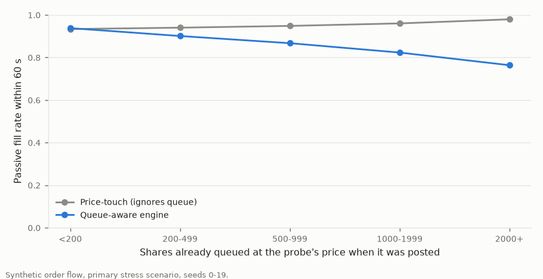

# Naive Fill Assumption vs. Queue-Aware Simulation

This is this project's equivalent of a gross-vs-net-of-costs comparison;
`PROJECT.md` §9 explains why a P&L comparison is replaced by an
execution-quality comparison for a microstructure simulator. The method
was fixed before running (DECISIONS.md ADR-008), and the finding is
recorded in ADR-004.

> **Scope:** all numbers come from synthetic order flow (ADR-001) under
> the designed stress scenario (ADR-002). They describe this model, not
> any real market.

Reproduce with `python scripts/run_study.py`. Tables are in `results/`
(`fill_comparison_*.csv`, `fill_comparison_mechanism.json`), and
per-probe rows go to `data/processed/probes_all.csv.gz`.

## Design in one paragraph

Every 15 s of simulated time, a 100-share buy is posted at the best bid
and a 100-share sell at the best ask. That is 14,280 decisions over 20
seeds, of which 23 were skipped because a side of the book was empty.
Each probe may wait 60 s; anything unfilled is then cancelled and
completed with a market order. The same background event log is judged
three ways:

- **naive:** instant, full fill at the posted price;
- **price-touch:** fill when any trade prints at or through the posted
  price, ignoring queue position;
- **queue-aware:** the probe is actually inserted into the matching
  engine behind every order already at its price.

## Headline table (all probes)

| | Naive (instant fill, no queue) | Price-touch, no queue | Realistic (price-time priority + queue) |
|---|---|---|---|
| Fill rate (passive, within 60 s) | 100% | 94.8% | **86.9%** |
| Average fill price vs. posted price | 0.00 ticks | +0.43 ticks worse | **+0.84 ticks worse** |
| Effective spread realized, `2·side·(price − mid at decision)` | −1.40 ticks (earned) | −0.59 ticks (earned) | **+0.26 ticks (paid)** |
| Median time to fill | 0 s | 3.3 s | 10.6 s |
| Markout, `side·(mid 60 s after decision − price)` | +0.73 ticks | +0.31 ticks | −0.13 ticks |

(`results/fill_comparison_overall.csv`; 14,257 probes per column.)

## Mechanism

**1. Queue position. This is the part the naive assumption ignores
outright.** A probe joins the back of its level. In this model it waits
behind a median 600 shares, and fills only if market orders plus
cancellations ahead of it clear that queue within 60 s. The recorded
queue state shows the effect directly:

| Shares queued ahead when posted | Probes | Price-touch fill rate | Queue-aware fill rate |
|---|---|---|---|
| < 200 | 1,142 | 93.3% | 93.8% |
| 200–499 | 4,082 | 94.0% | 90.1% |
| 500–999 | 5,144 | 94.8% | 86.7% |
| 1,000–1,999 | 3,504 | 96.0% | 82.3% |
| 2,000+ | 385 | 97.9% | 76.4% |

1,181 probes, 8.7% of all price-touch fills, saw a trade print at their
own price but never reached the front of the queue. Their median queue
ahead was 900 shares, against 600 for probes that did fill. Queue
position accounts for 7.9 of the 13.1 percentage points of fill-rate
gap, and for 0.85 of the 1.66 ticks of effective-spread gap.

**2. Price never reaching the order.** This part is ignored by the naive
assumption but captured by price-touch. It accounts for the other 5.2
points and 0.81 ticks. A probe that is not filled pays twice. It gives
up the spread it expected to earn, and its cleanup crosses the spread
after the price has usually moved away from it.

**3. Adverse selection.** The naive markout is positive (+0.73 ticks),
because a naive fill always happens at a price better than mid. The
queue-aware markout is negative (−0.13 ticks). The fills a real queue
grants tend to be the ones where flow is running through the level, and
the price keeps going.

## By window and side

The comparison was run on the stressed flow, so it can be split by
window. The gap already exists in the calm pre-event window. Before any
stress, queue-aware probes earn only −0.40 (buy) and −0.21 (sell) ticks
of effective spread, against −1.32 naive. So the headline is not an
artifact of the 5-minute event, which contains about 5% of probes.
During the event, the gap concentrates on one side:

| Event window (sell-side burst) | Naive | Price-touch | Queue-aware |
|---|---|---|---|
| **Sell probes** (resting on the ask): fill rate | 100% | 65.0% | **43.0%** |
| Sell probes: price vs. posted | 0.00 | +8.85 ticks | **+13.83 ticks** |
| Sell probes: effective spread | −2.40 | +14.53 | **+24.48** |
| **Buy probes** (resting on the bid): fill rate | 100% | 100% | 100% (median 1.9 s) |
| Buy probes: markout | −18.25 | −18.25 | −18.27 |

- **Sell probes.** Market sells sweep the bid, and the mid falls a
  median 99.5 ticks during the event. Asks posted at the start of a
  probe's life are left behind and never trade. Cleanup then sells into
  a bid far below. The naive assumption instead books those orders as
  filled at the ask just before the fall (naive sell markout +20.9
  ticks). It reports a windfall exactly where the realistic simulation
  reports the largest cost.
- **Buy probes.** The sweep clears any queue within seconds, so every
  assumption fills and all three show the same −18-tick adverse
  selection. On this side, what matters is being in the book at all,
  not queue position.

Full table: `results/fill_comparison_by_window_side.csv`.

## Is the order flow really identical?

The background event stream is byte-identical across the three
assumptions. Queue-aware probes, however, are real orders: they absorb
parts of market orders that would otherwise have reached background
orders. The perturbation was measured (ADR-008 addendum):

- best bid or ask differs from the no-probe replay in 11.2% of 1 s
  samples (9.4–12.3% across seeds);
- 4.7% of probe decisions (667 of 14,280) saw a different best quote;
- 31.7% of background fills are not reproduced exactly, mostly size
  shifts that cascade after a probe takes part of a market order;
- the strategy's own earlier probes are 4.4% of the queue ahead.

Restricting to the 13,590 decisions posted at the same price in both
replays leaves the conclusions unchanged:

| Same-posted-price subset | Naive | Price-touch | Queue-aware |
|---|---|---|---|
| Fill rate | 100% | 95.1% | 87.1% |
| Effective spread | −1.36 | −0.57 | +0.28 |

(`results/fill_comparison_overall_same_posted.csv`.)

## What this does and does not show

It shows that, in this model, a backtest that fills passive orders
instantly at the posted price turns a small net cost into an apparent
1.4-tick spread capture per fill. About half of that error comes from
queue position, and the error is largest in the direction of a strong
move.

It does not estimate the size of the error on a real venue. Queue
depths, cancellation behavior and adverse selection there differ from
this zero-intelligence model, and the 100-share probe and 60 s patience
are single, arbitrary design choices.
