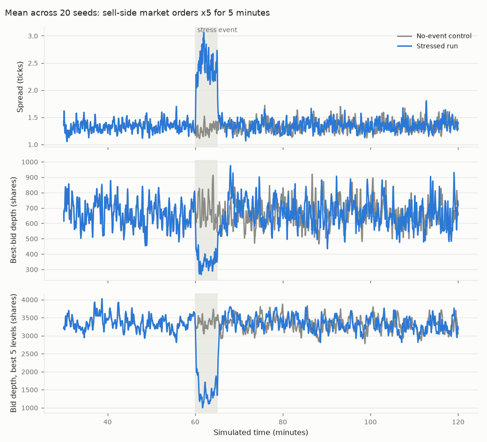
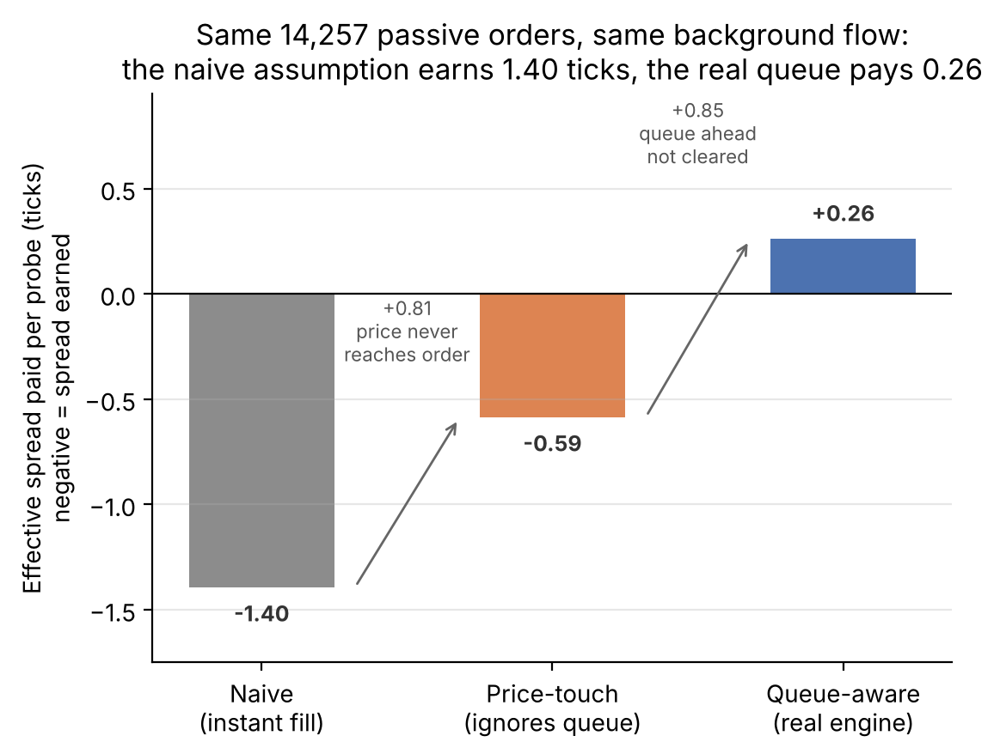
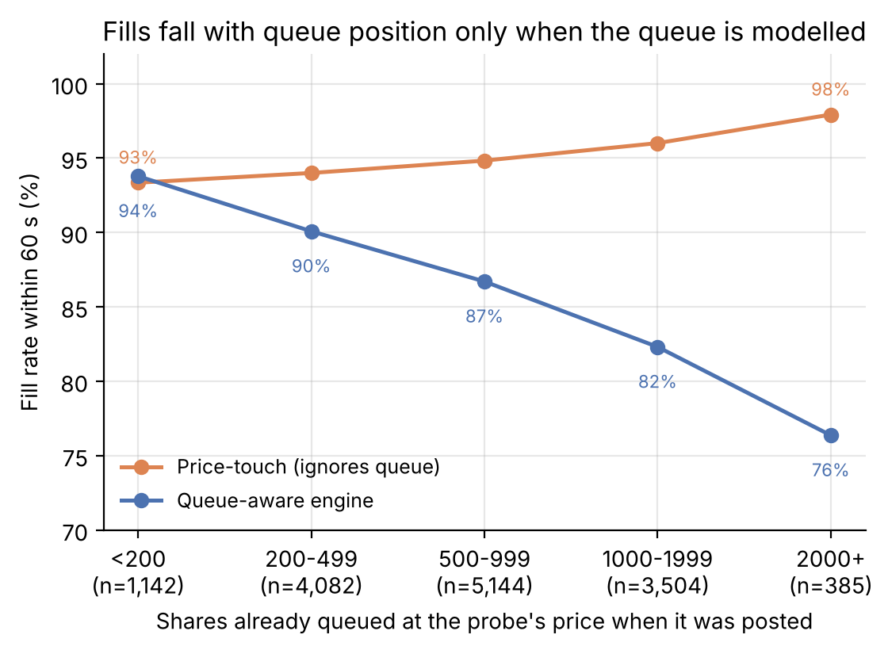

# A Price-Time Priority Order Book Simulator, a Controlled Liquidity Stress Experiment, and the Cost of Ignoring the Queue

**Muhammad Mateen Iqbal**
BS Data Science, Institute of Computing & IT, University of Lakki Marwat, Pakistan
muhammadmateen1024@gmail.com

Working paper, version 1.1 — October 2026
Code, tests and all recorded outputs: <https://github.com/mateeniqbal3/lob-simulator>

---

## Abstract

I build a limit order book matching engine with exchange-style
price-time priority, in-place partial fills that keep queue position,
and per-order lifecycle accounting. I verify it with targeted tests,
randomized invariant checks after every event, a differential test
against an independent brute-force matcher, and a bug-reintroduction
check in which all 15 injected bugs were caught. I then use it for two
experiments on a calibrated zero-intelligence order-flow model, both
designed in advance.

In the first, a 5-minute burst of market sells at five times the
baseline rate, compared with same-seed no-event controls over 20 seeds,
widens the spread by a median 1.18 ticks and removes about half of
top-of-book bid depth, in all 20 seeds. Liquidity then recovers in
27–54 s. I argue that this speed is a mechanical consequence of the
model's exogenous liquidity supply, not a finding about markets.

In the second, passive probe orders run on identical background flow
show that the textbook naive assumption, instant fill at the posted
price, reports 1.40 ticks of spread earned per order. The queue-aware
engine shows the same orders paying 0.26 ticks net. About half of the
gap comes from queue position and half from the price never reaching the
order. All results come from synthetic order flow and are a methodology
demonstration, not evidence about any real market.

**Keywords:** limit order book, matching engine, price-time priority,
market microstructure, liquidity resilience, queue position, fill
probability, backtesting, simulation

**JEL classification:** C63, D47, G14

---

> **Framing.** Every result in this writeup comes from synthetic order
> flow generated by a documented zero-intelligence model, with a
> deliberately designed stress scenario. It is a methodology
> demonstration. Nothing here describes, or should be read as evidence
> about, any real market, instrument or date.

## 1. Motivation

Two questions come up whenever a simulated or backtested execution
result is presented:

- **Is the matching mechanism right?** Many plausible-looking
  simulations quietly fill orders out of priority, move partially filled
  orders to the back of the queue, or create and destroy volume. The
  rest of the analysis inherits any such error.
- **Would the orders actually have filled?** Backtests of passive
  strategies routinely assume that a posted order fills when, or even
  before, the price touches it. That ignores the queue already waiting
  at that price.

This project treats the first question as the primary engineering
deliverable and the second as the primary empirical one. The event study
sits between them. It checks that the simulated book responds to stress
in the direction microstructure reasoning predicts, and it measures how
fast.

**Related work.** Gould et al. (2013) survey limit order books and the
models used to simulate them, and Bouchaud et al. (2018) give a
book-length treatment of order flow, impact and resilience.
Zero-intelligence models (Smith et al., 2003; Cont, Stoikov & Talreja,
2010) show that many statistical features of the book follow from the
matching mechanism alone; the queue-reactive model of Huang, Lehalle &
Rosenbaum (2015) makes order arrival depend on queue sizes. Resilience
after a large trade is central to optimal-execution models such as
Obizhaeva & Wang (2013), and the cost of being filled when better-informed
flow is trading against you goes back to Glosten & Milgrom (1985). This
project contributes no new model. It contributes a verified engine and a
controlled measurement of how much a common backtesting shortcut
overstates passive execution quality.

## 2. Matching engine

**State.** Each side of the book is a sorted list of occupied prices
(integer ticks). Each price holds an insertion-ordered dictionary of
resting orders. Insertion order *is* time priority. Cancelling any order
is O(1), and a partial fill or a size reduction changes an order's
quantity in place, so its position cannot change.

**Rules.**
- An incoming order trades against the best opposite price first, and
  within a price against the earliest order.
- The trade price is the resting order's price.
- A limit order's remainder rests; a market order's remainder expires.
- Cancels of unknown, filled or already-cancelled orders are rejected
  and counted rather than raised, because in live flow a cancel can race
  a fill.
- Invalid input (a non-positive quantity, a non-integer price, a
  duplicate id, an out-of-order timestamp) raises.

The book itself refuses a crossing insert, so a matching bug that failed
to match a marketable order would fail loudly, not persist as a crossed
book.

**Verification** (`docs/engine_correctness.md`):
1. The five properties required by the specification, each with a
   hand-built book: price priority, time priority, partial-fill queue
   preservation, cancellation, and no look-ahead.
2. Sixty seeded adversarial random streams. They use a narrow price
   band, so many orders are marketable, plus exact timestamp ties,
   oversized market orders, and partial, full and unknown cancels.
   Per-order accounting (`qty = filled + cancelled + expired + resting`),
   side-level volume conservation and full structural invariants are
   checked after every event.
3. A differential test. On the same streams, every fill and the final
   book must match a deliberately naive matcher that re-sorts the book
   before every match and shares no code with the engine.
4. A bug-reintroduction harness, which injects 15 specific bugs one at
   a time: LIFO queues, a partial fill sent to the back, double credit
   on fills, a missing time-order guard, and others. Each one fails the
   test written for it.

Known gaps are listed rather than implied away:
- two properties are guarded by a single test each;
- 15 mutations are a sample;
- the engine has never seen real exchange messages.

## 3. Order-flow model and calibration

The model is zero-intelligence, in the spirit of Smith et al. (2003) and
Cont, Stoikov & Talreja (2010):

- limit orders arrive per side at 1.0/s;
- a buy is placed `d` ticks below the best ask (a sell `d` ticks above
  the best bid), with $P(d) \propto d^{-0.5}$ on 1–10 ticks, so limit orders
  never cross;
- market orders arrive per side at 0.20/s;
- each resting order is cancelled at 0.05/s;
- limit sizes are 100 × U{1..5} shares and market sizes
  100 × Geometric(0.4).

The simulation is exact (competing Poisson clocks). It restarts the
clock at every change in rates, so nothing before a scheduled event
depends on it.

Calibration used no-event runs on seeds reserved for the purpose. The
first three parameter sets produced a book that was too deep and too
static: the spread was at 1 tick 98–100% of the time, and the mid moved
2–10 ticks in 90 minutes. I then wrote down four targets:

1. a mean spread of 1.2–3 ticks;
2. mean best-bid depth of 2–5× the mean market order;
3. both sides non-empty more than 99.9% of the time;
4. a moving mid.

Two of four further configurations met all of them. I chose the one
with rounder parameters and fewer events. It has a mean spread of 1.34
ticks, best-bid depth 2.7× the mean market order, and a 42-tick mid
range. All seven configurations are listed in
ADR-001.

## 4. Experiment 1: controlled liquidity stress

**Design** (fixed in ADR-002 before any stressed run):
- **Scenario:** the sell market-order rate goes from 0.20 to 1.00/s for
  300 s at t = 3,600 s. Nothing else changes.
- **Windows:** 30 minutes of warm-up are discarded, then there is a
  30-minute pre-event window and a 55-minute post-event window.
- **Replication:** twenty seeds, each run with and without the event.
  The two runs are event-for-event identical before 3,600 s, so each
  effect is a paired (stressed − control) difference.
- **Metrics:** spread, best-bid depth and best-5-level bid depth, sampled
  every second as of that second.
- **Recovery time:** from the end of the event until the trailing 30 s
  mean is back within 10% of the run's own pre-event mean. The same rule
  applied to the control run gives a placebo.

**Results.**
- **During the event:** the median spread was 2.45 ticks against 1.28
  (+1.18, IQR 1.02–1.36, 20/20 seeds). Best-bid depth was 349 shares
  against 705 (20/20), and best-5 bid depth 1,474 against 3,346 (20/20).
- **The spread effect is understated:** the bid side was completely
  empty in a median 6% of event samples, where the spread is undefined
  and excluded.
- **Ask side:** it thinned as well (−272 shares at the best ask). That
  is plausibly because new asks are placed relative to a falling bid,
  though I did not verify the mechanism.
- **Price:** the mid fell a median 99.5 ticks and, with no fundamental
  value in the model, did not revert.
- **Recovery:** median 27 s for the spread, 54 s for best-bid depth and
  38 s for best-5 depth. The placebos were 0 s, 2 s and 0 s. No run was
  censored. Five minutes after the event, window means were
  indistinguishable from control.
- **Robustness:** across the pre-registered grid (2×/5×/10× ×
  60/300/900 s), the direction of every during-event effect holds in
  every cell. The effects scale with intensity (spread +0.25 to 0.31,
  +1.07 to 1.19, +1.89 to 2.09 ticks) but barely with duration. Median
  recovery never exceeds a minute. At 2× it is hard to tell apart from
  placebo noise, and at 10× the bid side is empty for about a third of
  the event.

*Figure 1. Mean across the 20 seeds of the spread, best-bid depth and
best-5-level bid depth, for the stressed runs and their same-seed
no-event controls (10 s trailing means). The shaded band is the 5-minute
sell burst. Synthetic order flow; before minute 60 the two runs are
identical.*

**Interpretation.** The *direction* of each effect is what
microstructure reasoning predicts. The *speed* of recovery is not what
is typically argued for real markets. There, resilience depends on
liquidity suppliers who may withdraw or reprice after adverse flow; see
Foucault, Kadan & Kandel (2005) for a model in which resilience is
endogenous. In this model, three things drive recovery mechanically:

- liquidity supply is exogenous, so limit orders keep arriving at the
  baseline rate;
- orders are placed relative to the opposite quote, so a wide spread is
  refilled within seconds;
- resting orders live for about 20 s, so the book forgets the shock.

The result therefore validates the simulator's qualitative response. It
is not an estimate of how quickly real books recover. The obvious
extension is to make limit-order intensity respond to recent adverse
flow and measure the change in recovery time.

## 5. Experiment 2: naive vs. queue-aware execution

**Design** (fixed in ADR-008 before running):
- **Probes:** every 15 s, a 100-share buy at the best bid and a 100-share
  sell at the best ask, each patient for 60 s, then completed by market
  order. This runs on the primary stressed flow, for 14,257 probes over
  20 seeds.
- **Three assumptions on the same background event log:**
  - *naive*: instant fill at the posted price;
  - *price-touch*: fill when any trade prints at or through the posted
    price, ignoring the queue;
  - *queue-aware*: the probe is actually inserted into the engine,
    behind every order already at its price.

**Results.**

| | Naive | Price-touch | Queue-aware |
|---|---|---|---|
| Fill rate | 100% | 94.8% | 86.9% |
| Price vs. posted (ticks) | 0.00 | +0.43 | +0.84 |
| Effective spread (ticks) | −1.40 | −0.59 | +0.26 |
| Median time to fill | 0 s | 3.3 s | 10.6 s |
| 60 s markout (ticks) | +0.73 | +0.31 | −0.13 |

*Effective spread is 2 × side × (execution price − mid at posting), with
side +1 for buys and −1 for sells; the execution price averages the
passive fill and any market-order completion. Negative values mean spread
was earned. A positive markout means the mid later moved in the probe's
favour.*

*Figure 2. Effective spread per probe under each fill assumption, on the
same 14,257 probes and the same background flow. The arrows split the gap
into the price-reach and queue-position effects described below.*

**Mechanism.** The middle column separates two effects:

- **Price reach.** A posted order may simply never trade because the
  price moves away. This costs 5.2 points of fill rate and 0.81 ticks.
- **Queue position.** The price reaches the order, but the queue ahead
  is not cleared in time. This costs 7.9 points and 0.85 ticks. The
  recorded queue state shows the effect directly: queue-aware fill rate
  falls from 93.8% with fewer than 200 shares ahead to 76.4% with 2,000
  or more. Price-touch fill rates are flat or rising across the same
  buckets. 1,181 probes saw a trade at their own price and still did not
  fill; their median queue ahead was 900 shares, against 600 for probes
  that filled.
- **Adverse selection.** The negative queue-aware markout means the
  fills a real queue grants are disproportionately the ones where flow
  is running through the level.

*Figure 3. Fill rate within 60 s by the number of shares already queued at
the probe's price when it was posted. Only the queue-aware engine shows
fills falling with queue position.*

**The gap is present before any stress.** In the calm pre-event window,
the queue-aware effective spread is −0.40 (buys) and −0.21 (sells)
against −1.32 naive. During the event, it concentrates on the side that
benefits from the move:

- Asks resting while sellers sweep the bid filled 43% of the time
  (naive: 100%). The unfilled ones were completed 13.8 ticks below
  posted.
- The naive assumption books all of them as filled just before a
  100-tick fall.
- Bids filled 100% under every assumption, with the same −18-tick
  markout. There, the sweep makes queue position irrelevant.

**Identical flow, measured.** The background event stream is identical
across assumptions, but queue-aware probes are real orders and perturb
the book:

- best quotes differ from the no-probe replay in 11.2% of seconds;
- 4.7% of decisions were posted at a different price;
- 31.7% of background fills are not reproduced exactly, mostly size
  shifts;
- own probes make up 4.4% of the queue ahead.

Restricting to decisions posted identically in both replays changes the
headline by at most 0.04 ticks and 0.3 points.

## 6. Limitations

- **Synthetic only.** Real-data validation was attempted, but the free
  LOBSTER sample now requires a trial-account application (ADR-003).
- **Simple model.** One instrument; zero-intelligence flow with no
  informed traders, seasonality, or feedback from price to flow; limit
  orders never cross on arrival.
- **Simplified engine.** No hidden liquidity, auctions, latency,
  self-trade prevention or pro-rata matching.
- **Model-dependent results.** Both experiments' magnitudes depend on
  the calibrated parameters, chosen by hand against stated targets. The
  probe design (size, patience, placement) is a single choice.
- **Mechanical resilience.** Section 4 explains why the recovery speed
  in particular does not transfer.
- **One disclosed post-hoc change.** One fill-comparison diagnostic was
  replaced after the first full run because it double-counted. No
  pre-specified metric changed (ADR-008 addendum).

## 7. Reproducibility

`bash scripts/run_simulation.sh` runs the tests, the bug-reintroduction
check and the full study, and writes every number above to `results/`.
The runs are deterministic given the documented seeds; four full runs
produced identical pre-specified results. Library versions are in
`results/run_metadata.json`. The figures in this paper are produced by
`python paper/make_figures.py` from the committed outputs in `results/`.

## Data and code availability

All code, tests, the design record (`DECISIONS.md`) and every recorded
output are available at <https://github.com/mateeniqbal3/lob-simulator>
under the MIT License, and each release is archived on Zenodo (the DOI is
listed in the repository README). No market data are used; all order flow
is generated by the documented model from fixed seeds.

## Acknowledgements and AI-use disclosure

AI tools (Claude, Anthropic) were used to assist with parts of the
software implementation and with drafting and editing this paper. All
research decisions, including the pre-specified experimental designs,
were made and approved by the author, who takes full responsibility for
the content. Any errors are the author's own.

## References

Bouchaud, J.-P., Bonart, J., Donier, J., & Gould, M. (2018). *Trades,
Quotes and Prices: Financial Markets Under the Microscope*. Cambridge
University Press.

Cont, R., Stoikov, S., & Talreja, R. (2010). A stochastic model for order
book dynamics. *Operations Research*, 58(3), 549–563.

Foucault, T., Kadan, O., & Kandel, E. (2005). Limit order book as a market
for liquidity. *Review of Financial Studies*, 18(4), 1171–1217.

Glosten, L. R., & Milgrom, P. R. (1985). Bid, ask and transaction prices in
a specialist market with heterogeneously informed traders. *Journal of
Financial Economics*, 14(1), 71–100.

Gould, M. D., Porter, M. A., Williams, S., McDonald, M., Fenn, D. J., &
Howison, S. D. (2013). Limit order books. *Quantitative Finance*, 13(11),
1709–1734.

Huang, W., Lehalle, C.-A., & Rosenbaum, M. (2015). Simulating and analyzing
order book data: The queue-reactive model. *Journal of the American
Statistical Association*, 110(509), 107–122.

Obizhaeva, A. A., & Wang, J. (2013). Optimal trading strategy and
supply/demand dynamics. *Journal of Financial Markets*, 16(1), 1–32.

Smith, E., Farmer, J. D., Gillemot, L., & Krishnamurthy, S. (2003).
Statistical theory of the continuous double auction. *Quantitative
Finance*, 3(6), 481–514.
